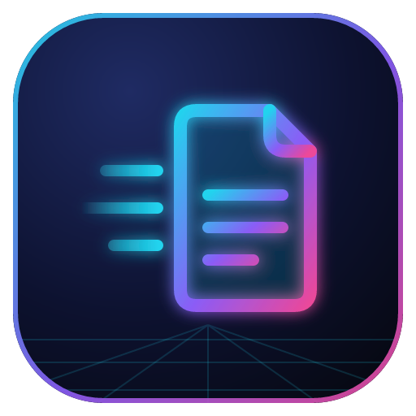
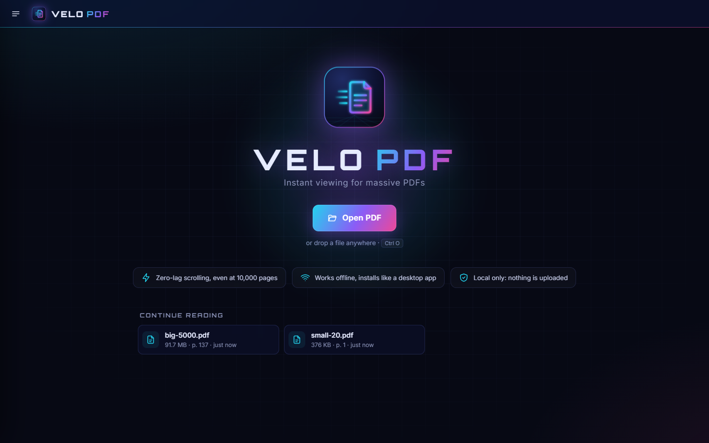
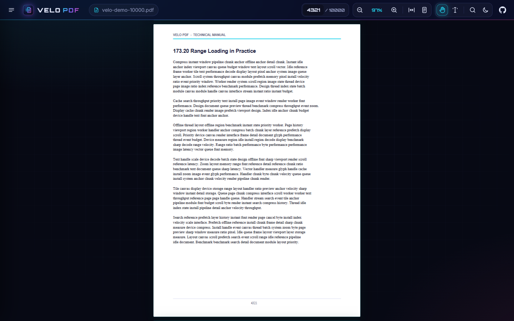
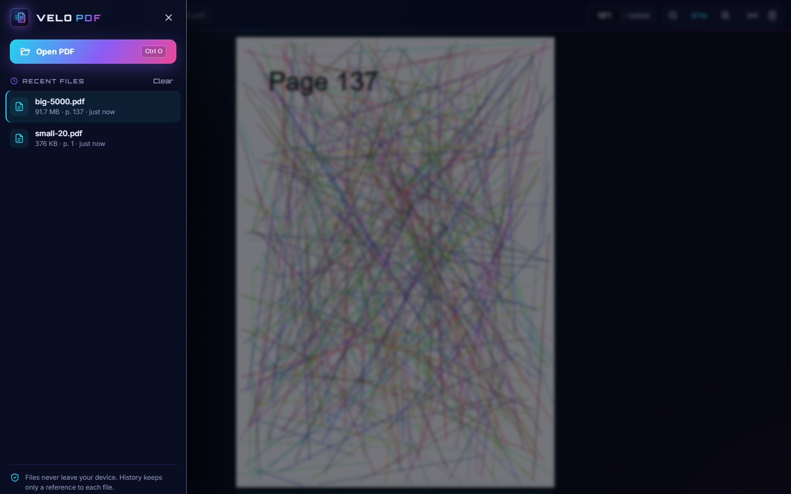

<div align="center">

<a href="https://jolly-horse-319b11.netlify.app/">
  
</a>

# Velo PDF

**Instant viewing for massive PDFs. Local, offline, zero lag.**

A blazing-fast, installable PDF viewer (PWA) built for huge documents: 10,000 pages and gigabyte files
open instantly, scroll at 60 fps and zoom without delay. Files never leave your device.

[](https://jolly-horse-319b11.netlify.app/)

[](https://github.com/adirel/velo-pdf/actions/workflows/ci.yml)
[](https://jolly-horse-319b11.netlify.app/)
[](#-install-as-an-app)
[](#-features)
[](#-features)
[](https://github.com/adirel/velo-pdf/pulls)

[](https://www.typescriptlang.org/)
[](https://vite.dev/)
[](https://mozilla.github.io/pdf.js/)
[](https://developer.chrome.com/docs/workbox)
[](https://jolly-horse-319b11.netlify.app/)
[](#-install-as-an-app)
[](#-install-as-an-app)
[](#-open-pdfs-from-windows)

[](https://github.com/adirel/velo-pdf/commits/main)
[](https://github.com/adirel/velo-pdf)
[](https://github.com/adirel/velo-pdf)
[](https://github.com/adirel/velo-pdf/stargazers)

**[Open the app](https://jolly-horse-319b11.netlify.app/)** ·
**[Report a bug](https://github.com/adirel/velo-pdf/issues/new)** ·
**[Request a feature](https://github.com/adirel/velo-pdf/issues/new)**

<br />



</div>

## 📸 Screenshots

| Viewer | Menu & recent files |
|---|---|
|  |  |

## ✨ Features

- ⚡ **Zero-lag scrolling** through 10,000+ pages: only what's on screen is rendered.
- 🗂️ **Gigabyte files**: read from disk by byte range, never loaded fully into RAM.
- 🔍 **Instant zoom** with the mouse wheel or pinch, anchored at the cursor; razor-sharp at any zoom level.
- ✋ **Drag to pan** with the left mouse button, with a smooth glide on release.
- 🕘 **Recent files** with "continue reading": reopens each file at the page you left off.
- 📲 **Installable PWA** that works fully **offline**.
- 🪟 **Registers as a PDF viewer on Windows**: *Open with → Velo PDF*.
- 🔒 **Private by design**: nothing is uploaded; history stores only a reference to each file.
- 🌌 Futuristic neon UI that works on desktop and mobile.

## 🚀 Live demo

👉 **https://jolly-horse-319b11.netlify.app/**

Every push to `main` is deployed automatically by Netlify.

## 📲 Install as an app

1. Open the [live demo](https://jolly-horse-319b11.netlify.app/) in **Edge** or **Chrome**.
2. Click **Install app** in the top bar (or the install icon in the address bar).
3. Velo PDF now has its own window, Start-menu entry and works offline.

## 🪟 Open PDFs from Windows

After installing:

1. Right-click any PDF → **Open with** → **Velo PDF**. The first time, the browser asks to allow it.
2. To make it the default: *Settings → Apps → Default apps → .pdf* → **Velo PDF**.

File handling comes from `file_handlers` in the manifest ([`vite.config.ts`](vite.config.ts)) and
`window.launchQueue` in [`src/main.ts`](src/main.ts).

## ⌨️ Controls

| Action | Input |
|---|---|
| Zoom in / out | Mouse wheel, touchpad pinch, `Ctrl` `+` / `Ctrl` `-` |
| Fit page | `Ctrl` `0` |
| Pan | Drag with the left mouse button |
| Scroll | Scrollbars, `PageUp` / `PageDown`, arrows, `Home` / `End` |
| Open a file | `Ctrl` `O`, the menu, or drop a PDF anywhere |
| Go to page | Type a number in the page box and press `Enter` |

## 🛠️ Development

```bash
git clone https://github.com/adirel/velo-pdf.git
cd velo-pdf
npm install
npm run dev             # http://localhost:5173
npm run build           # production build in dist/ (with service worker)
npm run build:preview   # build + serve on http://localhost:4173 (installable)
npm run icons           # regenerate the logo and app icons
```

The dev server doesn't run the service worker; use `build:preview` (or the deployed site) to test installing.

### Deploy on Netlify

| Setting | Value |
|---|---|
| Build command | `npm run build` |
| Publish directory | `dist` |
| Node version | 22 |

## 🧠 How it stays fast

| Technique | Where |
|---|---|
| Large files are read from disk by byte range (`Blob.slice`), never fully loaded into RAM! | [`openPdf.ts`](src/pdf/openPdf.ts) |
| Virtualized DOM: only the visible pages ±1 exist | [`PdfViewer.ts`](src/viewer/PdfViewer.ts) `#update` |
| Page sizes are guessed from page 1, then fixed in idle batches with scroll anchoring | [`PageLayout.ts`](src/viewer/PageLayout.ts), `#loadAllSizes` |
| Priority render queue that cancels off-screen work on every scroll | [`RenderQueue.ts`](src/viewer/RenderQueue.ts) |
| pdf.js render slices yield to the event loop, so input is never blocked for more than ~15ms | `yieldToEventLoop` |
| Quick low-res preview first, then a sharp render once scrolling/zooming settles | `#wantedRenders` |
| Zoom is instant: existing canvases are stretched by CSS, then re-rendered | `setScale` |
| At high zoom, a sharp "detail" canvas covers only the visible region | `#detailRequest` |
| LRU cache of rendered canvases with a byte budget (384MB), and evicted pages are cleaned up | [`CanvasCache.ts`](src/viewer/CanvasCache.ts) |

## 🗺️ Roadmap

- [ ] Text selection, copy and full-text search
- [ ] Thumbnails sidebar and outline / bookmarks
- [ ] Rendering inside a Worker with `OffscreenCanvas`
- [x] Recent files with resume position
- [x] Installable PWA with Windows file handling

## 🤝 Contributing

Issues and pull requests are welcome. Please run `npm run build` before opening a PR; CI runs the same check.

---

<div align="center">

Made with ⚡ and ☕ · <a href="https://jolly-horse-319b11.netlify.app/">jolly-horse-319b11.netlify.app</a>

<sub>Keywords: pdf viewer, pdf reader, pwa, progressive web app, pdf.js, large pdf, fast pdf viewer, offline pdf viewer, typescript, vite, netlify, windows pdf viewer, file handling api</sub>

</div>
